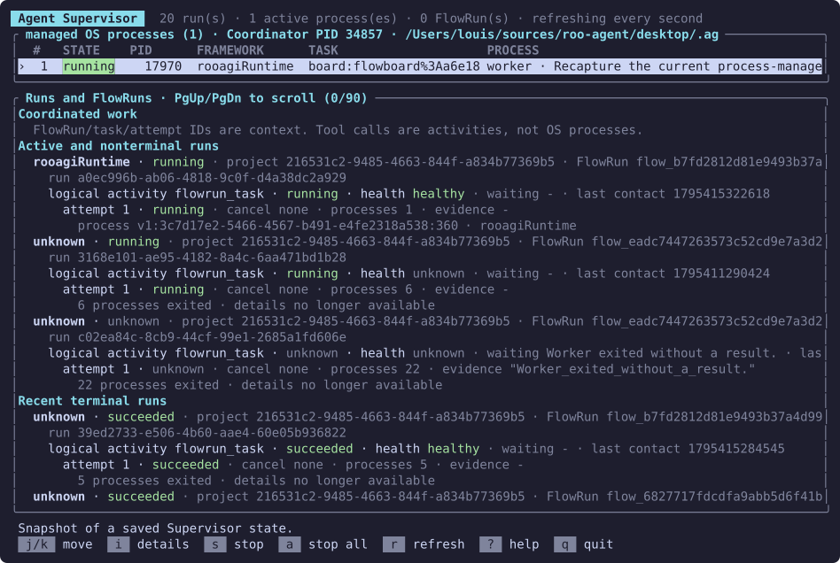

# RooAGI Agent Supervisor

**Supervise and contain the processes your agents start.**

Agent Supervisor gives your application control over every tool process it
launches: bound its output, enforce deadlines, cancel it, clean up its children,
and record how it finished. It supervises one-shot commands, persistent
subprocesses such as MCP servers, PTY sessions, and pipelines on Linux, macOS,
and Windows. You can embed it from Rust, Python, or Node.js, or run it as an
independent service that keeps processes alive while clients reconnect.

📖 **Documentation:** <https://rooagi.github.io/agent-supervisor/>

## Why

A tool call does not always end when its caller times out. A command can keep
running, leave child processes behind, or flood an application's output
buffers. Each tool adapter ends up reimplementing deadlines, output collection,
process-tree cleanup, and platform-specific behavior.

Agent Supervisor centralizes those responsibilities. Your application decides
what may run; Agent Supervisor runs it under an explicit policy and returns a
structured result, including after cancellation or failure.

It is useful for:

- **Agent framework developers** who want consistent execution and cleanup
  across tool adapters in Rust, Python, or Node.js;
- **Desktop and CLI applications** that need dependable cancellation, bounded
  output, and child cleanup; and
- **Hosts of MCP servers and other long-running subprocesses** that need
  startup, readiness, shutdown, and lifecycle events.

## Features

- **Bounded execution:** input and output limits, deadlines, cancellation, and
  TERM → grace → KILL shutdown.
- **Process-tree cleanup:** shared process groups and native containment so
  children do not outlive their owner.
- **Explicit policy:** cleared-by-default environments, filesystem grants,
  network disabling, and memory, process-count, and CPU limits where the
  platform supports them.
- **Agent runs:** scope the tools of one framework call to an `AgentRun` that
  cleans up its processes when it settles, alongside manager-owned background
  jobs that persist between runs.
- **Observability:** identity, liveness, resource statistics, lifecycle event
  streams, and structured termination results.
- **Long-running processes:** MCP servers, TCP/port/HTTP readiness probes,
  Unix PTYs and Windows ConPTY, and connected pipelines with stage-level
  failure receipts.
- **MCP adoption:** wrap an existing local stdio `rmcp` server with
  [`run_stdio_server`](docs/mcp.md#adopt-with-the-official-mcp-sdk).
- **Supervisor service:** an authenticated local service with a run
  coordinator and role-scoped clients, so processes are owned by the service
  rather than by a desktop or framework client.
- **Manage agent work:** the terminal manager shows live processes alongside
  active runs, recent run history, activity and attempt state, worker tool
  requests, and coordinated FlowRuns.
- **WebAssembly runner (opt-in):** run self-contained modules with no host
  imports under memory and fuel limits.

## How it fits

```text
agent runtime → authorized request → Agent Supervisor → native child process
                                                       └→ opt-in WASM module
```

| Your runtime owns | Agent Supervisor owns |
| --- | --- |
| User, project, session, and turn identity | Request validation |
| Authentication and provider tokens | Native process creation and containment |
| Authorization and path-grant selection | Environment, filesystem, and network policy |
| MCP configuration and tool metadata | Deadlines, output limits, cancellation, cleanup |
| Hooks, audit, retry, and orchestration | Process ownership, identity, and lifecycle events |

Agent Supervisor never resolves credentials or makes authorization decisions.
An MCP client can run through it, but provider authentication stays with your
runtime. It is a process boundary, not a hosted agent platform or a complete
container runtime.

## Install

| Language | Install |
| --- | --- |
| Rust | `cargo add agent-supervisor` and `cargo add tokio --features macros,rt-multi-thread` |
| Python (3.9+) | `python -m pip install agent-supervisor`, or with a framework extra such as `'agent-supervisor[openai]'` |
| Node.js | `@rooagi/agent-supervisor` in [`clients/node`](clients/node/README.md); build the embedded addon from a checkout with `npm run build:native` |

Python extras: `openai`, `microsoft`, `langgraph`, `pydantic-ai`, `google-adk`,
`mcp`, and `fastmcp`. To build any package from source, see
[`python/README.md`](python/README.md) and the
[Node.js client README](clients/node/README.md).

## Quickstart

Run a command under the default policy. Commands run without a shell, and the
executable must be an absolute path.

```rust
use agent_supervisor::{run, Command, Policy};

#[tokio::main]
async fn main() -> Result<(), Box<dyn std::error::Error>> {
    let command = Command {
        argv: vec!["/usr/bin/env".into(), "echo".into(), "hello".into()],
        cwd: None,
    };
    let result = run(&command, &Policy::default()).await?;
    print!("{}", String::from_utf8_lossy(&result.stdout));
    Ok(())
}
```

```python
import asyncio
import sys
from agent_supervisor import Command, Policy, run

async def main():
    result = await run(
        Command([sys.executable, "-c", "print('hello from a supervised process')"]),
        policy=Policy(),
    )
    print(result.stdout.decode(), end="")

asyncio.run(main())
```

```js
import { Command, Policy, run } from '@rooagi/agent-supervisor'

const result = await run(
  new Command([process.execPath, '-e', "console.log('hello from a supervised process')"]),
  { policy: new Policy() }
)
process.stdout.write(result.stdout)
```

Supervise an agent framework call so its tools are cleaned up when it ends.
This example uses the OpenAI Agents SDK adapter:

```python
import asyncio
from agents import Agent
from agent_supervisor import Supervisor
from agent_supervisor.openai import Runner

agent = Agent(name="Assistant", instructions="Answer the user's question clearly.")

async def main():
    supervisor = Supervisor()
    try:
        result = await Runner.run(agent, "What does Agent Supervisor do?", supervisor=supervisor)
        print(result.final_output)
    finally:
        await supervisor.shutdown_all()

asyncio.run(main())
```

The default policy keeps host networking and unrestricted filesystem access
for compatibility. Narrow it for tools that need less. See the
[quickstart](docs/quickstart.md) and
[agent runs and SDK adapters](docs/api-boundaries.md).

## Embedded and service modes

**Embedded mode:** your application owns its children in-process through
`Supervisor`, using the same Rust core from Rust, Python, or Node.js. This is
the default and works on all three platforms.

**Service mode:** `agent-supervisor-service` owns processes independently of
any client. A desktop app or framework can disconnect and reconnect, then
reattach to a process by its stable Supervisor process ID. The service:

- authenticates clients over a Unix-domain socket with separate `view`,
  `control`, and `tui` role tokens, plus per-process output and per-attempt
  reporter and canceller capabilities;
- runs a **coordinator** that tracks runs, activities, worker attempts, and
  FlowRuns with epoch/cursor-ordered event subscriptions; and
- with `--state-dir`, journals coordinator state so terminal outcomes survive
  a service restart. Unresolved launches are reported as unknown rather than
  replayed.

```sh
cargo build --release --bin agent-supervisor-service
agent-supervisor-service --init-credentials-dir "$XDG_CONFIG_HOME/agent-supervisor"
```

The standalone service currently supports Unix only; Windows uses embedded
mode. See the [Node.js client](clients/node/README.md) for the service setup,
the [run coordinator](docs/supervisor-coordinator.md), and the
[Supervisor guide](docs/supervisor-lifecycle.md).

**Terminal UI:** `agent-supervisor-tui` (built from [`tui/`](tui/)) inspects,
attaches to, and stops supervised processes. Its work panel separates active
and nonterminal runs from recent terminal runs, and shows their activities,
attempts, validated worker tool requests, and Supervisor FlowRuns. See the
[terminal process manager](docs/tui.md).

The frame below is a live capture from the TUI, showing the Supervisor and one
running managed process with its PID and metadata labels.



## Platform support

| Capability | Linux | macOS | Windows |
| --- | --- | --- | --- |
| Process-tree containment | Process groups, cgroup v2 | Process groups | Job Objects |
| Resource limits | cgroup v2 | See `platform_capabilities()` | Job Objects |
| Filesystem isolation | Landlock | `sandbox-exec` (Seatbelt) | AppContainer |
| Network disable (`NetworkMode::Disabled`) | ✓ | ✓ | ✓, requires a filesystem policy |
| PTY sessions | Unix PTY | Unix PTY | ConPTY |
| Supervisor service | ✓ | ✓ | Embedded mode only |

Enforcement depends on the operating system and the policy you pass. Call
`platform_capabilities()` before relying on optional behavior, and set
`EnforcementRequirement::Required` when a request must fail rather than run
with degraded enforcement.

## Security model

- **Environment:** child environments are cleared by default. Variables must
  be inherited or supplied explicitly, and dynamic-loader variables such as
  `LD_PRELOAD` and `DYLD_*` are rejected.
- **Filesystem:** `filesystem: None` keeps unrestricted access for
  compatibility. `Some(FilesystemPolicy::deny_all())` denies by default; add
  `FilesystemGrant` entries with absolute paths and explicit access rights.
- **Network:** `NetworkMode::Host` uses the host resolver, routes, firewall,
  and proxy environment with no namespace or allow-list.
  `NetworkMode::Disabled` denies IP networking while keeping local Unix IPC
  where supported.
- **WebAssembly:** with the `wasm` Cargo feature, modules that use the
  [guest ABI](docs/wasm-backend.md) run with no host imports, no filesystem or
  network, and fixed memory and fuel limits.

See the [security model](docs/security-model.md) and
[host network mode](docs/network-host-mode.md) for each platform's guarantees.

## OpenShell developer adapter (preview)

An adapter for NVIDIA OpenShell lives in `dev/openshell-adapter/`, outside the
published crate, because it depends on a Git-only SDK. It bounds collected
output and rejects policy requirements the remote API cannot apply or verify.
Read the [adapter contract](docs/openshell.md) before you experiment with it.

## Releases

The latest release is **0.3.3**. The persistent Supervisor service and its
coordinator were introduced in 0.3.1. See the [release notes](docs/releases/)
for release history.

## Contributing

Run the portable checks before you open a pull request:

```bash
cargo fmt --all -- --check
cargo test --all-targets -- --test-threads=1
cargo clippy --all-targets -- -D warnings
```

Platform integration tests must run on their native operating system;
cross-compilation does not replace native Linux, macOS, or Windows testing. See
[testing and coverage](docs/testing.md).

## License

Licensed under the [Apache License, Version 2.0](LICENSE). You may use, modify,
and distribute it, including in open-source and commercial agent products,
subject to the license terms.
