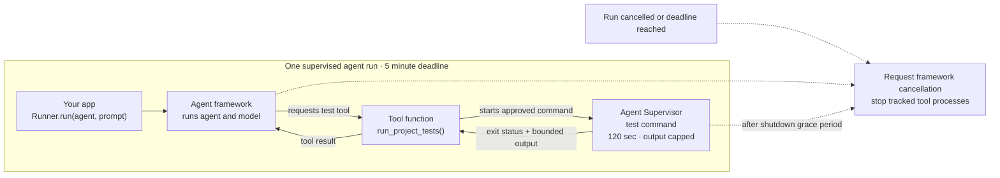

# Core Concept

Agent Supervisor provides two connected controls for agent applications:
an **agent run** gets a deadline and cleanup lifecycle, while each **local
tool process** gets its own command policy and process controls.

Your agent framework still runs the agent, makes model requests, and chooses
which tool to call. Agent Supervisor does not sandbox the agent's code or model
requests. It manages the run boundary and any local commands or MCP servers
that your tool functions start through Agent Supervisor.

This page explains the shared concepts and their Rust and Python names. For
signatures and complete examples, see the [Rust API](rust-api.md) and
[Python API](python-api.md).

## Example: the agent runs project tests

The app gives its agent one test-running tool. The framework decides when to
call it; the tool function starts the test command through Agent Supervisor.
The five-minute run deadline covers the whole agent call, while the 120-second
timeout and output caps below apply only to the test command.

At normal completion, the result returns through the tool to the agent. If the
run is cancelled or reaches its deadline, Agent Supervisor requests
cancellation from the framework and stops local processes it started after
their shutdown grace period. This covers multiple tool calls and agent
handoffs within the run. It does not take ownership of unrelated subprocesses.

## Agent run lifecycle

An agent run is one invocation of an agent framework, not the lifetime of an
agent object or a separate agent operating-system process. The run scope wraps
that invocation:

| Stage | What happens |
| --- | --- |
| Start | Create a scope and start its overall deadline. |
| Run | Let the framework execute turns, handoffs, and tools. Tool functions start local commands through Agent Supervisor; those processes are registered with the active scope. |
| Finish | Observe the framework result, an error, caller cancellation, or the deadline. |
| Clean up | On cancellation or deadline, request cancellation from the framework run. Then give tracked tool processes their shutdown grace period and stop any that remain. |

Framework cancellation is cooperative. A deadline does not suspend or forcibly
kill agent code running inside your application process. The framework and app
code must respond to cancellation. Agent Supervisor can stop the separate
local processes it started.

| Run-level concept | Rust | Python |
| --- | --- | --- |
| Run scope and defaults | `AgentRunScope`; `AgentRunPolicy` | `AgentRunScope`; `AgentRunPolicy` (also used by framework adapters) |
| Overall deadline | `AgentRunPolicy.timeout` (default 300 seconds) | `supervision={"timeout": ...}` (default 300 seconds) |
| Process cleanup grace | `AgentRunPolicy.shutdown_grace` (default 5 seconds) | `supervision={"shutdown_grace": ...}` (default 5 seconds) |
| Cancel and clean up | `request_cancel()` then `cancel()`; or call `cancel()` directly | Adapter cancels the framework operation and cleans up at the deadline, cancellation, or completion |

Python framework adapters use the same Rust run scope and defaults. See
[Agent SDK integrations](api-boundaries.md) for framework-specific imports and
examples.

## Local tool process lifecycle

Within a run, each local command or stdio MCP server has its own lifecycle:

The run scope adds overall time and cleanup ownership around this process
lifecycle. Per-process limits and policy still apply to each command. The
public type names differ where Rust and Python API conventions differ.

## Lifecycle and terminology

| Step | Concept | Rust | Python |
| --- | --- | --- | --- |
| 1. Describe | The executable, arguments, and optional working directory. No shell is inserted. | `Command`; low-level execution can use `ExecutionRequest`, which also contains the policy. | `Command(argv, cwd=...)`; the binding builds the native request internally. |
| 2. Configure | The environment and controls requested for the child. | `Policy` (`SandboxPolicy`) groups `EnvironmentPolicy`, `FilesystemPolicy`, `NetworkMode`, `ResourceLimits`, and `EnforcementRequirement`. | `Command` holds environment and time/byte limits. `Policy` holds filesystem, network, and enforcement settings. |
| 3. Launch | Choose a bounded one-shot command or an interactive process. | `run` / `execute`; `Supervisor::start` for a persistent child. | `run` for one-shot; `stream` for one-shot output events; `Supervisor.start` for a persistent child. |
| 4. Exchange | Send stdin and observe stdout/stderr while the process runs. | `ProcessEventStream`, `ProcessEvent`. | `Process`, `OutputEvent`. |
| 5. Finish | Collect the outcome or stop a still-running child. | `ExecutionOutput` or `ProcessReceipt`; `TerminationReason`. | `RunResult`; `RunResult.termination`. |

## What the policy concepts mean

| Concept | Meaning | Rust term | Python term |
| --- | --- | --- | --- |
| Environment | The child starts with a cleared environment. Explicit variables and selected parent variables can be provided. | `EnvironmentPolicy` | `Command(env=..., inherit_env=...)` |
| Filesystem policy | `None` means no filesystem restriction was requested. An explicit empty policy denies access; grants list allowed access under directory roots. | `FilesystemPolicy`, `FilesystemGrant`, `FilesystemAccess` | `Policy(filesystem=[(path, access)])` |
| Network mode | `Host` shares host networking. `Disabled` requests denial of IP networking while retaining local Unix IPC where supported. | `NetworkMode::{Host, Disabled}` | `Policy(network="host" or "disabled")` |
| Resource limits | Bound runtime and stdin/stdout/stderr bytes. Rust also supports optional memory, process-count, and CPU limits. | `ResourceLimits` in `Policy` | `timeout` and `max_*_bytes` in `Command` |
| Enforcement requirement | Says whether the child may start if a requested native control is unavailable. | `EnforcementRequirement::{BestEffort, Required}` | `Policy(enforcement="best_effort" or "required")` |

Defaults are compatibility oriented: host networking, no requested filesystem
restriction, and best-effort enforcement. Environment inheritance and numeric
limits follow each language API's documented defaults. Host operating systems
provide different controls, so inspect platform capabilities when a particular
restriction is required.

## Results are different from requirements

Two values answer different questions:

- **Enforcement requirement** is part of the policy. `BestEffort` allows
  execution when a requested native control cannot be applied; `Required`
  makes launch fail in that case.
- **Enforcement outcome** is part of the result. `Enforced`, `Degraded`,
  `Unavailable`, or `Trusted` describes what the backend reports it applied.
- **Termination** describes why the child stopped: for example, it exited,
  timed out, was cancelled, or exceeded an output limit.

Rust represents termination as `TerminationReason`; Python exposes string
values through `RunResult.termination`. A nonzero exit is still an exited
process, so check the exit status or result success field as well.

## Process lifetime

One-shot execution starts the command, exchanges any provided input, collects
bounded output, and returns a final result. Use it when the caller does not
need to keep communicating with the process.

A persistent process remains available for multiple input/output exchanges.
Write bytes to stdin, close stdin to send EOF when finished, and keep reading
output events until the terminal event. `wait()` collects the final summary;
`shutdown(grace)` closes stdin, allows a short period for normal exit, and
then stops the process tree if it remains alive. A `Command` runtime timeout
applies to one-shot execution; persistent processes are stopped explicitly.

Python's `stream()` is an output streaming mode for a one-shot command: it
closes stdin immediately. Use `Supervisor.start()` and `Process` when a Python
child needs interactive stdin.

## Where to find API details

- [Rust API](rust-api.md): Rust types, signatures, return values, cancellation,
  persistent process methods, and examples.
- [Python API](python-api.md): Python constructors, async methods, return
  values, cancellation, platform capabilities, and examples.
- [Agent SDK integrations](api-boundaries.md): using the supervisor beneath
  popular agent frameworks.
- [MCP servers](mcp.md): supervising stdio MCP server processes.
