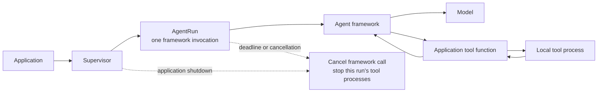
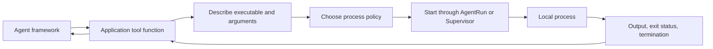

# Core concepts

Agent Supervisor has four layers. Each layer owns a different part of the
lifecycle, and the [Rust API](rust-api.md) and [Python API](python-api.md) pages
use the same layers.

```text
Application            creates the framework and one Supervisor
└── Supervisor         owns agent runs and background jobs
    ├── AgentRun       one framework call and the tools it starts
    │   └── Tool       local command or stdio MCP server process
    └── Background job a process that can continue between agent runs
```

| Layer | Owns | Rust and Python API |
| --- | --- | --- |
| **Application** | The agent framework, stored state, and the `Supervisor`. It decides which tool actions to allow. | Your code. There is no Agent Supervisor application type. |
| **Supervisor** | Every agent run and local process it starts, plus background jobs. It cleans everything up at shutdown. | `Supervisor` in Rust and Python. It lives in your process and is not a daemon. |
| **Agent** | One framework invocation: an overall deadline, cancellation, and the tools that call starts. | `supervisor.start_agent_run(policy)` returns an `AgentRun`; framework adapters do this for you. |
| **Tool** | One local command or stdio MCP server, with its policy, limits, output, and result. | `Command`, `Policy`, `run`, `start`, and `RunResult` / `ProcessReceipt`. |

The **agent** itself is the AI worker defined by your framework (instructions,
model, and tools). The **framework**, for example the OpenAI Agents SDK,
Microsoft Agent Framework, or LangGraph, runs the agent loop and invokes tool
functions. Agent Supervisor does not replace the framework or run agent code in
a separate process.

## Application

Your application creates the framework and one top-level `Supervisor`, passes
the supervisor to each framework call, and shuts it down when the application
exits. See the [Supervisor guide](supervisor-lifecycle.md#application-setup)
for startup and shutdown examples in both languages.

### Save framework state and background jobs

The framework or application stores conversation sessions and graph
checkpoints. Agent Supervisor does not store or restore that state. When a
workflow resumes, load the framework's checkpoint and start a **new
`AgentRun`** for the new framework invocation.

| State or resource | Owner | What happens on resume or restart |
| --- | --- | --- |
| Framework session or checkpoint | Framework and application | The framework can load it for a new `AgentRun`. |
| `SupervisorProcessId` | Application stores the token; the original `Supervisor` resolves it. | The same live supervisor can look up its job. A new supervisor reports the old ID as unavailable. |
| Operating-system process | The live `Supervisor` | The supervisor stops its processes when the application exits. The token does not recreate a process. |

`SupervisorProcessId` is a stable, serializable identity for a process in one
supervisor. It is different from the framework's job ID and the operating
system PID. After an application restart, parsing the old token still works,
but lookup returns unavailable (`None` in the Rust and Python APIs). Do not
automatically replay the command: it may have produced side effects before
the process stopped. If a process must survive an application restart, a
separate durable host service must own it.

See the language API examples for saving and resolving the token:
[Rust](rust-api.md#save-and-resume-background-jobs) ·
[Python](python-api.md#save-and-resume-background-jobs).

## Supervisor

`Supervisor` is the application's in-process owner for agent runs and local
child processes. It is not a daemon and does not keep jobs alive after the
application exits; see [Supervisor lifecycle](supervisor-lifecycle.md).

It manages two kinds of work:

- **Agent runs**, created with `start_agent_run()`. Each run is cleaned up when
  its framework call ends.
- **Background jobs**, created with `start_background()`. A job belongs to the
  supervisor, not to any one run, so it can continue between agent runs. Each
  job is addressed by a `SupervisorProcessId`.

### Input and output

Choose how a process is started by how you need to talk to it:

| Need | Input | Output | Past the output limit |
| --- | --- | --- | --- |
| One command, result at the end | One value passed to `run()` | Bounded stdout and stderr in the result | Stopped |
| Interactive process | Write and close stdin at any time | Output events as they arrive | Stopped |
| Background job | Write and close stdin by `SupervisorProcessId` | The newest output, read after the job finishes | Keeps running |

See the language examples: [Rust](rust-api.md#input-and-output) ·
[Python](python-api.md#input-and-output).

### Watching work

Starting work and watching it are separate. `run`, `start`, and
`start_background` launch work; `Supervisor.stream()` only watches it, as one
ordered stream of events. Stopping a watcher stops nothing.

| Watch | Shows | Ends when |
| --- | --- | --- |
| One process | Its output and exit. | It exits. |
| One agent run | The framework's events and its tools' output. | The run ends. |
| Everything | All of the above. | The supervisor is dropped. |

This stream is for your application. It is separate from what the model sees,
which is still the tool's return value. See the language references:
[Rust](rust-api.md#stream-output) · [Python](python-api.md#stream-output).

When the application shuts down, `shutdown_all(grace)` cancels active agent
runs, stops registered processes, and awaits the final results of background
jobs.

## Agent

An **agent run** is one framework invocation. `Supervisor` creates an
`AgentRun` for it. The run applies an overall deadline and cancellation
boundary, and associates the local tool processes started for that invocation
with the same cleanup boundary.



When an invocation is cancelled or reaches its deadline, framework cancellation
is cooperative: the framework must respond to its cancellation mechanism.
Agent Supervisor stops the separate local processes registered to that run
after their configured shutdown grace. It cannot forcibly kill agent code
running inside the application or stop a remote model request that ignores
cancellation. Direct Rust integrations call `cancel().await` after normal
completion; framework adapters perform that cleanup for you.

### Lifecycle of a resumable workflow

1. The application creates the `Supervisor`.
2. For each framework call, it calls `supervisor.start_agent_run(policy)` and
   runs the framework through the `AgentRun`.
3. When the call ends, the run stops its own tool processes. Background jobs
   keep running under the supervisor.
4. To resume, the application loads the framework checkpoint and starts a new
   `AgentRun`. It finds any background job through its saved
   `SupervisorProcessId` on the same live `Supervisor`.

For framework-specific examples, see
[Agent SDK integrations](api-boundaries.md).

## Tool

The framework decides which tool to call. Your application implements the
tool function and decides whether to allow the requested action. If that
function starts a local command or stdio MCP server through Agent Supervisor,
the supervisor applies the process policy, manages input and output, and
reports how the process finished.



Choose the process API based on how long the tool should live:

| Need | API | Who handles the process after launch |
| --- | --- | --- |
| Run one command and collect its result | Rust `run` / `execute`; Python `run` | The call collects bounded output and returns a result. |
| Keep a process interactive for one agent run | Rust `AgentRun::start()` or `Supervisor::start()`; Python `AgentRun.start()` or `Supervisor.start()` | Your code uses the returned child/process handle for input, output, and waiting. In Rust, `into_event_stream()` also publishes output to supervisor watchers; raw pipes stay caller-owned. `Supervisor` can clean it up; `AgentRun` stops its own processes when that run ends. |
| Let a process continue between agent runs | Rust `Supervisor::start_background()`; Python `Supervisor.start_background()` | `Supervisor` drains output, observes exit, reaps the process, and retains the result under a `SupervisorProcessId`. |

For a background job, the process ID supports later status, result, input, and
shutdown calls. `shutdown_process(id, grace)` requests that one process tree
stop; `shutdown_all(grace)` stops the supervisor's jobs and awaits their final
results. For interactive processes, `shutdown_all()` requests a stop; callers
still use their child/process handles to drain output and observe the final
result.

### Process policy

The command describes the executable, arguments, and optional working
directory. The policy describes the environment and controls requested for
that child. No shell is inserted automatically.

| Concept | Meaning | Rust | Python |
| --- | --- | --- | --- |
| `ExecutionRequest` | Low-level executable, arguments, working directory, and policy to execute. | `ExecutionRequest` | Built internally from `Command` and `Policy`. |
| Environment policy | Starts with a cleared environment; explicitly released variables can be added. | `EnvironmentPolicy` | `Command(env=..., inherit_env=...)` |
| Filesystem policy | No restriction requested when omitted. An explicit empty policy denies access; grants list permitted access under directory roots. | `FilesystemPolicy`, `FilesystemGrant`, `FilesystemAccess` | `Policy(filesystem=[(path, access)])` |
| Network mode | `Host` shares host networking. `Disabled` requests denial of IP networking while retaining local Unix IPC where supported. | `NetworkMode::{Host, Disabled}` | `Policy(network="host" or "disabled")` |
| Resource limits | Bound one-shot runtime and stdin/stdout/stderr bytes. Rust also supports optional memory, process-count, and CPU limits. | `ResourceLimits` fields in `Policy` | `Command.timeout`, `max_stdin_bytes`, `max_stdout_bytes`, `max_stderr_bytes` |
| Enforcement requirement | Determines whether launch may continue when a requested native control is unavailable. | `EnforcementRequirement::{BestEffort, Required}` | `Policy(enforcement="best_effort" or "required")` |

Defaults are compatibility oriented: host networking, no requested filesystem
restriction, and best-effort enforcement. Environment inheritance and numeric
limits follow each language API's documented defaults. Host operating systems
provide different controls, so inspect platform capabilities when a particular
restriction is required.

### Process results

Three values describe different parts of the outcome:

- **Enforcement requirement** is part of the policy. `BestEffort` allows
  execution when a requested native control cannot be applied; `Required`
  makes launch fail in that case.
- **Enforcement outcome** reports what the backend says it applied:
  `Enforced`, `Degraded`, `Unavailable`, or `Trusted`.
- **Termination** describes why a process stopped: for example, it exited,
  timed out, was cancelled, or exceeded an output limit.

Rust returns `ExecutionOutput`, `ProcessReceipt`, or a background-job result
with `TerminationReason`. Python returns `RunResult` with
`RunResult.termination`. A nonzero exit is still an exited process, so check
its exit status or success field as well.

## API details

- [Rust API](rust-api.md): types, signatures, arguments, return values,
  cancellation, and examples.
- [Python API](python-api.md): constructors, methods, results, cancellation,
  platform capabilities, and examples.
- [Agent SDK integrations](api-boundaries.md): using the supervisor beneath
  popular agent frameworks.
- [MCP servers](mcp.md): supervising stdio MCP server processes.
