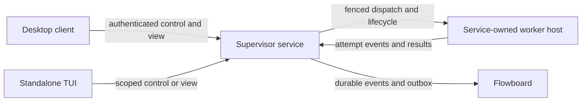

# Migrating FlowRun ownership to Agent Supervisor

The earlier FlowRun work (tasks 17–23) connected trusted workflow metadata,
desktop clients, the standalone TUI, and targeted process controls. The newer
service-coordination work (tasks 24–33) moves the long-lived workflow and worker
lifecycle into the independent Supervisor service. These are different
ownership guarantees: a process can be service-owned while its protocol loop or
workflow decisions still depend on Desktop.

## What tasks 17–23 established

| Earlier work | Contract retained |
| --- | --- |
| Task 17: trusted project and FlowRun context | Project, FlowRun, task, post, worker, runtime-run, and Supervisor process IDs remain distinct. Context is metadata; it does not grant authority. |
| Tasks 18–20: independent service and client integration | The service owns managed OS processes. Desktop and TUI connect as clients and can reconnect. Process output and exit receipts remain tied to the matching Supervisor process. |
| Task 21: Codex and Claude process routes | Provider launches carry trusted context, use the shared service, and support targeted process cleanup. The earlier adapter tests did not prove service-owned provider protocol handling across a Desktop disconnect. |
| Task 22: scoped permissions | View, Desktop control, and TUI control remain separate authenticated capabilities. The server enforces each role; hiding a UI action is not authorization. |
| Task 23: cancellation reconciliation | Cancellation is scoped to the current attempt, late results from replaced attempts are rejected, and stopping one worker leaves siblings alone. |

The acceptance records for tasks 17–23 also note their limits: service sockets
are Unix-only, provider checks used fixtures rather than authenticated live
Codex or Claude sessions, and external Runtime package checks require the
matching `@rooagi/contracts` package to be available. The task records are
historical evidence for those contracts; they do not replace the current
service integration checks.

## New ownership model

The service owns the coordinator epoch, FlowRun projection, task dispatch
reservations, attempt and process links, cancellation bookkeeping, and durable
Flowboard outbox. It continues deterministic lifecycle handling while client
connections come and go. Desktop remains a control and review client; explicit
review or stage decisions can still wait for an authorized reviewer.

For an application rollout:

1. Run one service instance with a persistent `--state-dir` and the configured
   Flowboard and worker connections. The state-directory lock prevents two
   service processes from owning the same journal.
2. Authenticate Desktop and TUI with their scoped role credentials. Register
   FlowRun and task context from trusted application state, and keep runtime
   invocation payloads out of snapshots and journal records.
3. Let the service reserve and dispatch eligible attempts. A process exit is
   evidence for workflow reconciliation; it does not by itself approve or
   complete a Flowboard task.
4. Treat client close as a disconnect. On reconnect, read the current snapshot
   and event cursor before issuing commands; do not create a second scheduler
   for the same FlowRun.
5. Treat unresolved launch reservations after service restart as unknown. The
   service advances its epoch and fence and does not relaunch a side effect
   whose completion was not durably recorded. Framework checkpoint references
   remain framework-owned and must be verified by the adapter before any
   recovery action.

The service setup, protocol, role matrix, recovery behavior, worker invocation
boundary, and Unix socket limitation are described in the
[Run coordinator guide](supervisor-coordinator.md). The lower-level process
lifecycle remains in the [Supervisor guide](supervisor-lifecycle.md).
The [framework-neutral JSONL worker example](https://github.com/RooAGI/agent-supervisor/blob/main/examples/python/supervisor_jsonl_worker.py)
shows the configured start/cancel/result boundary without importing Desktop or
an agent framework.

## Provider protocol handoff status

The service-owned worker host now has Codex and Claude protocol loops and a
loopback MCP bridge. Supervisor's durable tool-call API and Desktop's
reconnect-aware PermissionMcpProxy executor are implemented with stable,
attempt-scoped request, claim, and result IDs. Focused service and Desktop
fixtures pass, but the combined Desktop-to-service-to-worker disconnect test
and uncertain side-effect timeout/cancellation recovery checks are still in
progress. Until those checks pass, this migration is not complete for provider
MCP calls. Do not treat an injected in-memory tool callback test as proof that
a provider tool call survives Desktop disconnect or service recovery.

The service also does not run an independent reasoning agent. It dispatches
eligible work and reconciles deterministic lifecycle events. Review and stage
handoffs remain explicit workflow decisions; a Desktop disconnect can leave a
FlowRun waiting at those boundaries without losing the service-owned worker
state.
